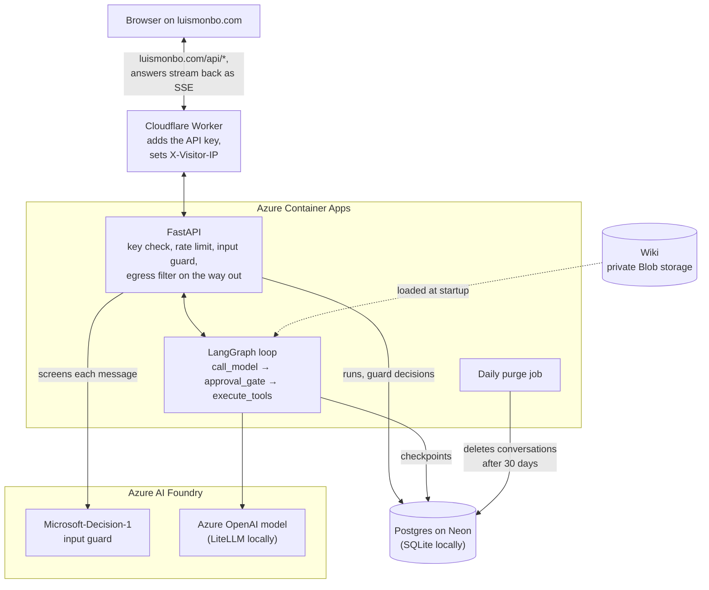

# Conductor

[](https://github.com/luismonbo/conductor/actions/workflows/ci.yml)
[](LICENSE)

An agent harness: the platform an AI agent runs on, with its model access, tools, memory, human
approvals, evaluations and deployment. Built on LangGraph and FastAPI, it runs the public
assistant on [luismonbo.com](https://luismonbo.com). Getting an agent to answer is the easy
part. Putting one in front of anonymous visitors also takes a key the browser never sees,
per-visitor rate limits and a cost ceiling, a guard that refuses what it cannot check,
evaluations that catch regressions, and conversations that expire. This repo builds those
parts, each behind an interface, so a model, a store or a whole agent changes by configuration.

## Live demo

The assistant on [luismonbo.com](https://luismonbo.com) answers questions about Luis's
background, work and projects, from a hand-written wiki. It runs on a small budget, so these are
limits, not bugs:

- All visitors share 300,000 tokens a day. Once they are spent, the assistant says it has reached
  its limit for today, until midnight UTC.
- Each visitor can send 15 messages a minute. Past that, the chat asks you to wait a minute.
- A message over 2,000 characters gets a request to shorten it instead of an answer.
- In a long conversation it sees only your last 10 messages and its replies to them.
- Questions on other topics, tasks such as writing code or translating, and requests for its
  instructions or for private information get a short fixed refusal.

## Architecture



Dependencies point inward: `api → orchestration → agents → adapters → core`. `core/` holds the
ports and types (LLM, tools, memory, RAG, guard, wiki) and imports nothing outside the standard
library and the harness itself, so anything behind a port is swapped by configuration.

## Design decisions

- **Approvals pause the graph.** A tool with `requires_approval = True` stops the run with
  LangGraph's `interrupt()`, and the checkpointer keeps the paused state, so no request or worker
  waits on a person. The answer can come minutes later, from another tab or after a restart:
  `POST /resume/{thread_id}` continues the run with approve, deny, or feedback for the model. An
  answer counts only for the interrupt it names, so a stale or repeated one gets 409 instead of
  deciding the wrong call.
- **Layers point inward.** Adapters implement the ports in `core/`, and one composition root
  ([build.py](src/harness/orchestration/build.py)) picks them from settings, so a model
  provider, a store or the entry agent is a configuration change: both LLM clients speak the
  OpenAI chat format
  ([openai_wire.py](src/harness/adapters/llm/openai_wire.py)), Azure OpenAI in production and a
  LiteLLM proxy locally ([litellm_config.yaml](litellm_config.yaml): Ollama, Anthropic, OpenAI,
  Gemini or DeepSeek); an agent is a folder under `src/harness/agents/`; a deployment is a file
  in `config/targets/`. The same seams let the tests run on fakes, with no network.
- **RAG is scored in two layers.** Retrieval is scored alone, with no LLM: recall@k, MRR and
  nDCG@k against labeled relevant chunks or documents, after a check that the index holds the
  corpus the labels were written for. It is deterministic and takes seconds, so retrieval
  settings can be swept. Generation is scored separately by an LLM judge that returns a
  structured verdict per answer: faithfulness (is it fully supported by the retrieved text?) and
  answer relevancy (does it address the question?). Each layer fails below its committed
  thresholds.
- **Trade-offs.**
  - Security over availability: when the guard cannot decide, the message is refused, so a
    classifier outage stops the chat instead of letting messages through unchecked.
  - Simplicity over scale: the rate limiter and the one-run-per-thread claim live in memory,
    which holds the deployment to one replica.
  - A wiki over RAG for the public agent: the model reads an index and opens the pages it needs,
    with no embeddings or retrieval settings to tune, at the cost of keeping the pages current
    by hand.
  - No tracing vendor: runs and guard decisions are rows in the app's own database, read with
    [scripts/db.py](scripts/db.py), so there is no hosted UI for browsing traces.

## Production and safety

- **The key never reaches a browser.** The page calls `luismonbo.com/api/*`, where a Cloudflare
  Worker adds the shared API key and sets `X-Visitor-IP`. The API trusts that header only on a
  request that carries the valid key, so any proxy that injects the key must set or strip it.
- **Per-visitor limits and a cost ceiling.** Rate limits key on the visitor's address (an IPv6
  address as its /64): 15 a minute on the routes that call the model, 60 elsewhere, and the
  limiter's key is never logged. Messages are capped in length, each model call in output tokens,
  and all visitors together by a daily token budget derived from the provider's monthly quota.
- **Input guard.** Microsoft-Decision-1 screens every message for prompt extraction, requests for
  private information and off-topic use before the agent sees it, with thresholds calibrated on
  labeled cases. It fails closed: when it cannot decide (the classifier fails or leaves a check
  out, or the daily budget cannot be read), the message is refused, so the chat answers only
  messages it could check. Refusals come in the visitor's language, from a fixed table no model
  writes.
- **Egress filter.** Everything a browser receives passes [egress.py](src/harness/security/egress.py),
  deny by default: an exception never becomes browser text, tool arguments and results stay on
  the server unless the deployment allows them (an approval card shows the call it asks about),
  and an unknown event type is dropped.
- **Visitor data.** An anonymous random `sid` cookie (HttpOnly, Secure, a session cookie on the
  public site) scopes threads to their visitor. A daily Container Apps Job deletes conversations
  30 days after their last message, and an alert fires when a day passes without a clean run.
  Long-term memory stays off in public, because its store isn't partitioned per visitor yet.
- **Least privilege.** The app reaches the model and the wiki with its managed identity, and its
  secrets come from the Container App's environment, never from the committed target file.
  Checkpoints deserialize only an explicit list of types.
- **Observable without a vendor.** Every run is recorded with its agent, backend, timing, stop
  reason, tokens and iterations, and every guard decision with its probabilities;
  [scripts/db.py](scripts/db.py) reads both.
- **Bad configuration fails at startup, not in front of a visitor.** The app refuses to start
  with auth on and no key, with the guard on and no endpoint, with an entry agent that doesn't
  resolve or lacks what it needs (the website agent without its wiki), or with a credential in a
  target file.

## Evaluation and testing

- [run_eval.py](evaluation/run_eval.py) drives the real LangGraph agent over a dataset and scores
  tool choice, arguments and answers.
- [run_retrieval_eval.py](evaluation/run_retrieval_eval.py) and
  [run_rag_eval.py](evaluation/run_rag_eval.py) score RAG's two layers, retrieval and generation
  (see [Design decisions](#design-decisions)).
- [run_guard_eval.py](evaluation/run_guard_eval.py) calibrates the input guard; it is rerun
  whenever the website agent's prompt changes.
- Datasets and pass thresholds are committed; run reports are not.

About 1,200 tests (unit, integration, contract and graph scenarios) need no network and no
credentials: `uv run pytest -q`, or `make test` with the frontend's. CI runs ruff, mypy and the
suite, with the Postgres tests on `pgvector/pgvector:0.8.6-pg18`, the versions Neon runs; a
missing database fails them instead of skipping them.

## Scope and known limitations

- It runs one public assistant over one shared knowledge base. There are no accounts and no
  tenants: a visitor is an anonymous session cookie.
- Long-term memory is off on the public site, because its store isn't partitioned per visitor
  yet.
- It can run as only one replica: the rate limiter and the one-run-per-thread claim keep their
  state in memory.
- Each agent works alone: there is no delegation from one agent to another.
- Retrieval is vector search only, with no hybrid search, reranking or citations. The public
  site doesn't use it; its agent reads the wiki.
- The RAG judge is the same model that wrote the answer, so it grades its own work.
- The input guard checks for prompt extraction, requests for private information and off-topic
  use. It has no check aimed at jailbreaks or other abuse.
- The assistant's refusals come in English, Spanish, Italian, French or German; any other
  language gets English.
- The evaluations, and the frontend's tests and type-check, run only locally; CI checks the
  backend.

## Quick start

Needs Python 3.13 and [uv](https://docs.astral.sh/uv/). Until you configure a model, a fake one
answers with a fixed sentence, so this needs no credentials:

```bash
uv sync
export HARNESS_API_KEY=$(openssl rand -hex 32) HARNESS_INPUT_GUARD_ENABLED=false
uv run uvicorn harness.api.main:app --app-dir src &

curl --retry 10 --retry-connrefused localhost:8000/health   # waits for the server to start
curl -N localhost:8000/chat/stream -H "Authorization: Bearer $HARNESS_API_KEY" \
  -H 'content-type: application/json' -d '{"message": "hello"}'
```

The full stack, with real models through the LiteLLM proxy, Postgres and the chat UI, needs Docker
and pnpm. In `.env`, set `HARNESS_API_KEY` and `HARNESS_INPUT_GUARD_ENABLED=false`, uncomment the
LiteLLM block, and set `HARNESS_DEFAULT_MODEL` to a profile you can run: `ollama-gemma` after
`ollama pull gemma4:e2b`, or `claude`, `gpt`, `gemini-flash` or `deepseek-flash` with that
provider's key. `.env.example` turns on the public site's limits, with a smaller daily budget
(33,000 tokens for all visitors); `HARNESS_MAX_MESSAGE_CHARS`, `HARNESS_MAX_OUTPUT_TOKENS` and
`HARNESS_DAILY_TOKEN_BUDGET` at `0` turn them off.

```bash
cp .env.example .env   # then edit it as above
make up                # Postgres and the LiteLLM proxy
make api               # the API on :8000
make web               # in a second terminal: the chat UI (after `pnpm -C frontend install`)
```

## Layout

```text
src/harness/
├── core/            ports and types: LLM, tools, memory, RAG, guard, wiki
├── adapters/        implementations: llm, tools, memory, guard, wiki, RAG ingestion, vector stores
├── agents/          one folder per agent: default (tools, memory, RAG) and website (the public one)
├── orchestration/   the LangGraph loop, agent loading, the composition root, storage, retention
├── security/        the input guard, the egress filter, the visitor-facing texts
├── observability/   logging, tracing, token counting, the run store
├── api/             FastAPI routes, auth, sessions, rate limits, SSE
├── config/          settings and deployment targets
└── cli/             ingest, rag_query, purge
evaluation/          agent, retrieval, RAG and guard evaluations
frontend/            React and TypeScript chat: streaming, approval cards, model picker, threads
scripts/             local tools for conversations, runs and the vector index (scripts/README.md)
```

## Configuration

Settings are `HARNESS_*` environment variables, documented in [.env.example](.env.example). A
deployment is a target: `HARNESS_TARGET=<name>` layers `config/targets/<name>.yaml` under the
environment ([example.yaml](config/targets/example.yaml)), and a target never holds a secret. The
ones to know first:

| Variable | Default | |
|---|---|---|
| `HARNESS_LLM_BACKEND` | `fake` | `openai_compatible` (LiteLLM, llama.cpp, vLLM) or `azure` |
| `HARNESS_AGENT` | `default` | the entry agent's folder under `src/harness/agents/` |
| `HARNESS_CHECKPOINTER` | `sqlite` | `memory`, `sqlite` or `postgres`: threads and the run store |
| `HARNESS_API_KEY` | none | required while `HARNESS_AUTH_ENABLED` is `true`, the default |
| `HARNESS_INPUT_GUARD_ENABLED` | `true` | needs `HARNESS_AZURE_ENDPOINT`; turn it off for local use |

## License

[Apache License 2.0](LICENSE). Copyright 2026 Luis Monge.
